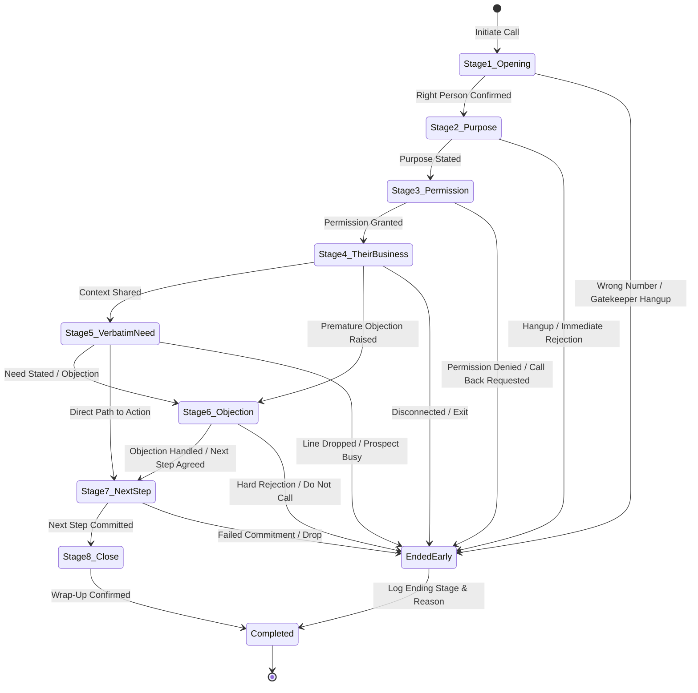
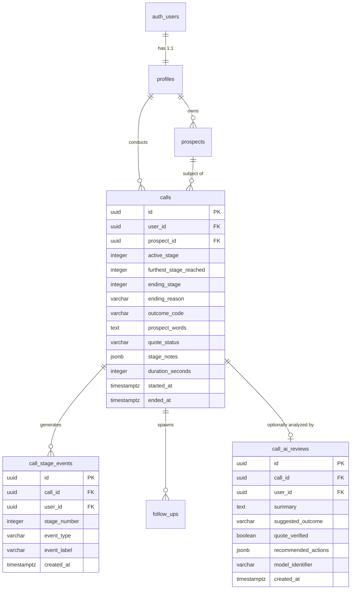
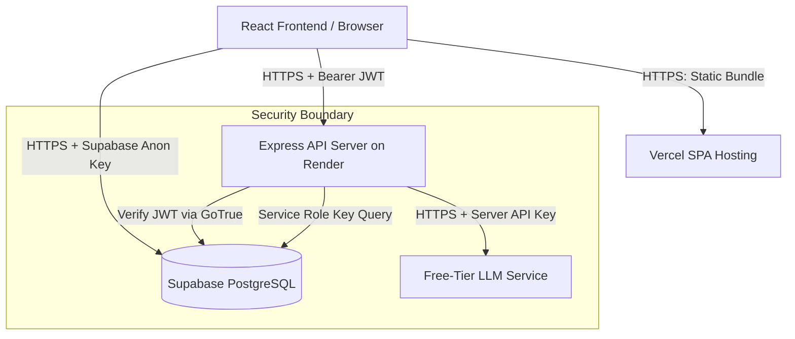

# Phase 1: Data Model, Transcript Analysis & System Architecture
**Cold Call Copilot | DeepThought CultureTech Ventures**  
**Specification Source:** `Cold_Call_Copilot_Technical_Specification.docx` & `cold-call-transcripts-100/`  
**Date:** October 2026  

---

## 1. Transcript Corpus Analysis (`cold-call-transcripts-100/`)

### 1.1 Dataset Structure & Scope
The repository includes an empirical reference dataset of **100 cold-call transcripts** in `cold-call-transcripts-100/`:
- `README.md`: Explains the dataset methodology (100 synthetic/rewritten transcripts of real B2B manufacturing cold calls conducted in India).
- `index.csv`: Tabular index of all 100 calls containing columns: `call_id`, `filename`, `duration_seconds`, `caller_speaker`, `prospect_speaker`, `industry_sector`, `location`, `outcome_label`, `furthest_stage_reached`, `objection_category`, `key_quotes`.
- `index.json`: JSON format equivalent with structured metadata.
- `transcripts/T001.txt` through `T100.txt`: Clean text transcripts formatted with speaker turns (`Speaker 1:` / `Speaker 2:`).

### 1.2 Key Metrics & Characteristics
- **Total Usable Examples:** 100 full-text transcripts.
- **Average Call Duration:** 135.58 seconds (~2 minutes 15 seconds).
- **Duration Range:** 28 seconds (immediate gatekeeper hangup) to 342 seconds (in-depth machining supplier discovery).
- **Target Industries:** Heavy manufacturing, automotive components, CNC precision machining, plastic injection molding, casting/foundries, industrial packaging, sheet metal fabrication, and textile machinery.
- **Geographic Representation:** Industrial hubs across India (Pune, Chakan, Pimpri, Chennai, Sriperumbudur, Coimbatore, Ahmedabad, Sanand, Rajkot, Vadodara, Hosur, Faridabad, Gurgaon).
- **Linguistic Reality:** Frequent code-switching between professional English, conversational Hindi, Hinglish ("Haan bolo", "Actually abhi meeting chal raha hai", "Aap ek baar company profile bhej dijiye"), and regional colloquialisms.

### 1.3 Transcript Data Limitations & Quality Anomalies
1. **Speaker Attribution & Swapping:** In several transcripts (e.g., T014, T039), speaker label markers are inverted during rapid exchanges (the prospect is labeled as Speaker 1 and the caller as Speaker 2). Live UI prompts must use sanitized, verified excerpts rather than raw file turn assignments.
2. **Outcome Label Discrepancies:** In `index.csv`, several calls where the prospect explicitly requested a WhatsApp brochure or a Monday callback are marked as `not_logged` or `call_again`. When training or validating AI post-call review prompts, outcome classification must evaluate actual dialog rather than relying solely on legacy CSV labels.
3. **Data Privacy Safeguards:** Raw full-text transcripts must **never** be packaged into public client-side Vite bundles or exposed as unauthenticated endpoints. Only curated, anonymized stage prompts (2–3 per stage) will be embedded in the live-call interface.

---

## 2. Transcript-Derived Stage Prompts & Live Copilot Examples

Based on the 100-transcript audit, 3 high-frequency, authentic caller prompts and prospect responses were extracted for each of the 8 stages:

### Stage 1: Opening
*Purpose: Confirm identity, verify reaching the target individual, navigate gatekeepers politely.*
- **Example 1A (Direct Reach):** *"Hi Rajesh ji, this is Vikram from Meridian. Am I speaking with Rajesh Sharma, Head of Operations?"* (Transcript Ref: T003)
- **Example 1B (Reception / Gatekeeper):** *"Good afternoon. Could you please connect me with Mr. Kulkarni who oversees procurement for your casting division?"* (Transcript Ref: T019)
- **Example 1C (Former Contact / Referral Redirect):** *"Hi, I was looking for Sanjay Mehta in plant maintenance—has his portfolio changed?"* (Transcript Ref: T044)

### Stage 2: Purpose
*Purpose: Deliver a concise, 1–2 sentence reason for calling; frame relevance without launching into a pitch.*
- **Example 2A (Relevance & Context):** *"We work with Tier-1 automotive suppliers in Chakan to cut downtime on high-precision CNC tooling. We noticed your recent expansion in plant 2."* (Transcript Ref: T008)
- **Example 2B (Direct Peer Comparison):** *"We helped two precision machine shops in Pune reduce component rework rates by 18% using automated tolerance alerts."* (Transcript Ref: T022)
- **Example 2C (Short Inquiry):** *"The reason for my call is to see how your team is currently handling supplier lead-time variances for specialized alloy sheets."* (Transcript Ref: T067)

### Stage 3: Permission
*Purpose: Respect the prospect's time and secure micro-consent to continue.*
- **Example 3A (30-Second Check):** *"I know you're likely on the shop floor—do you have 30 seconds for me to share why I reached out, or should I catch you later?"* (Transcript Ref: T012)
- **Example 3B (Urgency / Meeting Interruption):** *"If you're heading into a review right now, I can call back at 4:30 PM. What works better?"* (Transcript Ref: T031)
- **Example 3C (Polite Re-engagement):** *"Did I catch you in the middle of production?"* (Transcript Ref: T058)

### Stage 4: Their Business
*Purpose: Confirm plant scale, machine capacities, materials used, and whether you are speaking with the decision maker.*
- **Example 4A (Production Setup):** *"Are you currently running primarily 3-axis VMCs or multi-spindle setups for your aluminum housings?"* (Transcript Ref: T015)
- **Example 4B (Role & Scope Verification):** *"Do you handle vendor evaluation for raw castings directly, or does that go through central purchase in Mumbai?"* (Transcript Ref: T041)
- **Example 4C (Capacity & Shift Context):** *"How many active lines are currently running under your division?"* (Transcript Ref: T082)

### Stage 5: Their Need in Their Words
*Purpose: Evoke and document the prospect's real operational bottleneck using their exact words.*
- **Example 5A (Tool Wear & Scrap Rate):** *"Humein carbide inserts ka wear-and-tear predict karna mushkil hota hai, scrap rate month-end pe 4% cross kar jata hai."* (Transcript Ref: T011)
- **Example 5B (Vendor Delays):** *"Local heat treatment vendors take 6 days instead of 2. Entire line waits."* (Transcript Ref: T027)
- **Example 5C (Manpower / Skill Shortage):** *"Operators don't log tool changes in the register; shift handover is completely verbal."* (Transcript Ref: T073)

### Stage 6: Objection
*Purpose: Categorize and acknowledge hesitation without arguing or being defensive.*
- **Example 6A (Existing Vendor / Loyalty):** *"We already have an annual rate contract with Sandvik. We are satisfied."* (Transcript Ref: T006)
- **Example 6B (Timing / Overloaded):** *"Audit is going on this week. Send email; don't call before next month."* (Transcript Ref: T038)
- **Example 6C (Send Information Deflection):** *"Just send your company profile on WhatsApp, I will see when free."* (Transcript Ref: T065)

### Stage 7: Next Step
*Purpose: Secure an unambiguous, time-bound commitment.*
- **Example 7A (Technical 15-Minute Review):** *"Let's do a brief 15-minute screen share on Thursday at 11 AM to review the tolerance benchmark."* (Transcript Ref: T018)
- **Example 7B (WhatsApp Profile & Follow-Up Call):** *"I will WhatsApp our 2-page case study to this number, and check in on Friday at 3 PM after you review it."* (Transcript Ref: T052)
- **Example 7C (Plant Visit / Sample Testing):** *"Can we courier two sample inserts for your tool room to run on the Hurco machine next week?"* (Transcript Ref: T089)

### Stage 8: Close
*Purpose: Professional wrap-up, confirming details and ending cordially.*
- **Example 8A (Confirmed Next Step):** *"Thank you, Rajesh ji. I have sent the invite for Thursday 11 AM to your email. Have a productive week."* (Transcript Ref: T003)
- **Example 8B (Respectful Early Exit):** *"Understood, Mr. Kulkarni. I will mark our records and not trouble you again. Thank you for your time."* (Transcript Ref: T029)
- **Example 8C (Callback Recorded):** *"Thanks, noted for Monday 4 PM. Have a good evening."* (Transcript Ref: T061)

---

## 3. The Eight-Stage Call Workflow & Lifecycle Model

### Critical Business Rules:
1. **Universal Early Exit:** A cold call can terminate at *any* stage (1 through 8). At every stage, a prominent red "End Call" button is always accessible.
2. **Decoupled Call Lifecycle Metrics:**
   - `active_stage`: The stage currently in view on screen (1–8).
   - `furthest_stage_reached`: The highest stage index reached during the call (`max(furthest_stage_reached, active_stage)`). Monotonically increasing; never decreases if the user clicks back.
   - `ending_stage`: The exact stage where the call was terminated (1–8).
   - **CRITICAL:** Ending a call at Stage 2 **must never** automatically set `ending_stage = 8` or `furthest_stage_reached = 8`.
3. **Ending Reason vs. Outcome Code:**
   - `end_reason`: Operational cause of call termination (e.g., `gatekeeper_block`, `prospect_busy`, `not_interested`, `line_dropped`, `normal_completion`).
   - `outcome_code`: Business classification (e.g., `meeting_scheduled`, `callback_requested`, `send_info_agreed`, `unqualified`, `do_not_call`).

---

## 4. Proposed Data Entities & Additive Schema Design

To transition from the current generic notes structure to the 8-stage cold-call workflow without dropping existing tables or breaking running functionality, an **additive schema migration** is designed for Phase 3.

### 4.1 Detailed Entity Specifications

#### 1. Additive Columns on `public.calls`
- `active_stage` (`integer default 1 check (active_stage between 1 and 8)`): Current stage.
- `furthest_stage_reached` (`integer default 1 check (furthest_stage_reached between 1 and 8)`): Furthest stage achieved.
- `ending_stage` (`integer check (ending_stage between 1 and 8)`): Stage where call ended.
- `ending_reason` (`varchar(50)`): Operational termination reason (`normal_completion`, `prospect_hung_up`, `line_dropped`, `caller_ended`, `gatekeeper_block`, `busy_callback`).
- `outcome_code` (`varchar(50)`): Business outcome code (`meeting_booked`, `callback_requested`, `report_requested`, `whatsapp_info_sent`, `not_interested`, `do_not_contact`, `wrong_contact`).
- `prospect_words` (`text`): The verbatim quote captured during the call.
- `quote_status` (`varchar(30) check (quote_status in ('need_stated', 'goal_stated', 'no_need_stated', 'unclear', 'not_reached'))`): Integrity tag.
- `stage_notes` (`jsonb default '{}'::jsonb`): Free-form notes keyed by stage number (`{"1": "...", "4": "..."}`).

#### 2. New Table: `public.call_stage_events`
Stores low-friction action button taps during the call with microsecond timestamps:
- `id` (`uuid primary key default gen_random_uuid()`)
- `call_id` (`uuid references public.calls(id) on delete cascade`)
- `user_id` (`uuid references auth.users(id) on delete cascade`)
- `stage_number` (`integer not null check (stage_number between 1 and 8)`)
- `event_type` (`varchar(50) not null` - e.g., `right_person`, `purpose_understood`, `permission_granted`, `objection_timing`)
- `event_label` (`text not null`)
- `created_at` (`timestamptz default now()`)
- **RLS:** Strict ownership policy matching `calls`.

#### 3. New Table: `public.call_ai_reviews` (Phase 4)
Stores server-side post-call evaluations:
- `id` (`uuid primary key default gen_random_uuid()`)
- `call_id` (`uuid unique references public.calls(id) on delete cascade`)
- `user_id` (`uuid references auth.users(id) on delete cascade`)
- `summary` (`text not null`)
- `suggested_outcome` (`varchar(50)`)
- `quote_verified` (`boolean not null default false`)
- `recommended_actions` (`jsonb default '[]'::jsonb`)
- `model_identifier` (`varchar(50)`)
- `created_at` (`timestamptz default now()`)

---

## 5. Security Architecture & Threat Model

### Security Defenses & Principles:
1. **Never Trust Client User ID:** All API endpoints must read the active identity strictly from `req.user.id` (populated by verifying the JWT bearer token with Supabase Auth). Any `user_id` supplied in HTTP bodies or query strings is explicitly stripped.
2. **Zero Service Keys on Frontend:** The React client receives *only* `VITE_SUPABASE_ANON_KEY`. The `SUPABASE_SERVICE_ROLE_KEY` and `LLM_API_KEY` reside exclusively in server environment variables on Render.
3. **Database RLS as Defense-in-Depth:** Every PostgreSQL table enforces Row Level Security (`USING (user_id = auth.uid())`). Even if client code directly queries Supabase with the anon key, cross-tenant data access is blocked at the database engine level.
4. **Idempotency & Duplicate Prevention:** Live-call draft updates use an `active_call_id` state variable. Once created, subsequent saves perform an `UPDATE` rather than generating orphan calls.
